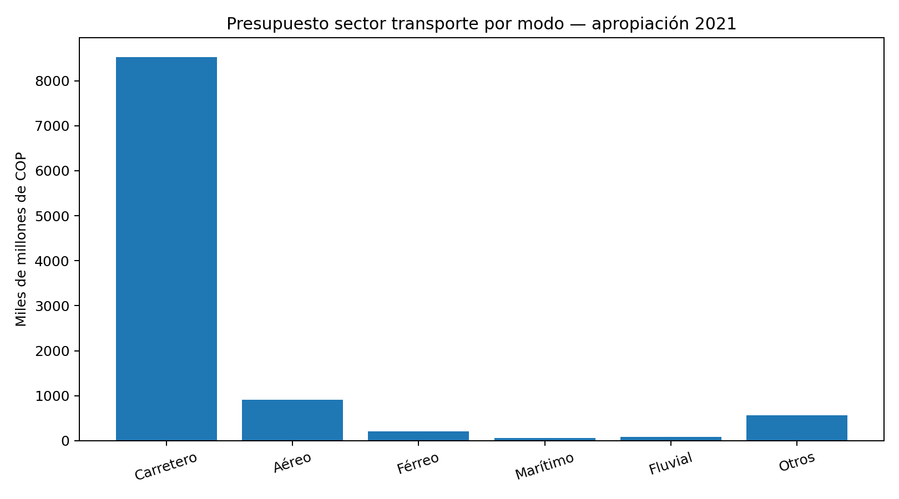
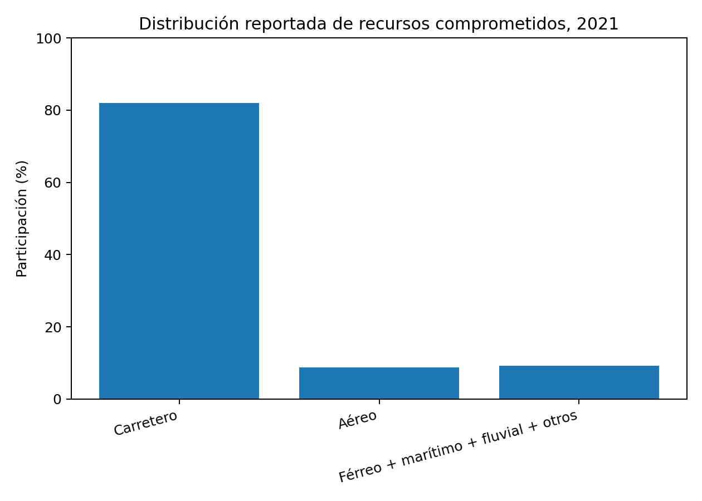
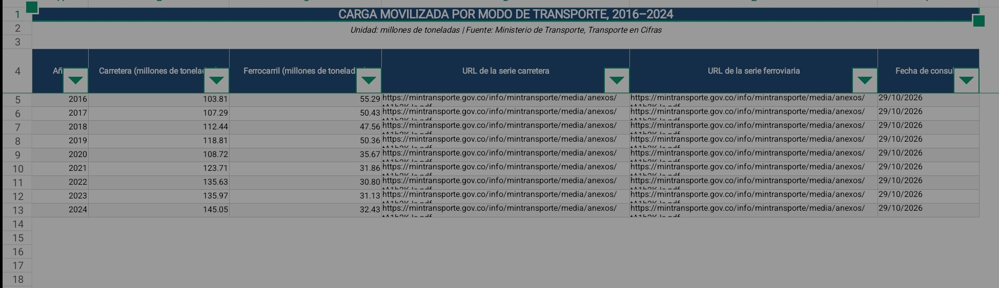
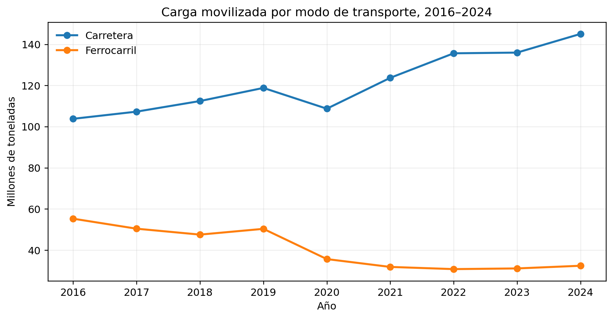

Grupo 1 · EAFIT

[Repositorio del proyecto en GitHub](https://github.com/mati020406-sys/Proyecto-grupo-1-)

## Pregunta original y delimitación

31 de julio de 2026. ¿Cuál es el efecto de la inversión en infraestructura vial de Colombia sobre el transporte de productos, comparado con la inversión en infraestructura ferroviaria?

Pregunta afilada: ¿Cómo se reparten la carga movilizada y la inversión pública entre carretera y ferrocarril en Colombia, 2016–2024?

La pregunta de julio, proporcionada textualmente por el grupo en esta revisión, planteaba un efecto. La pregunta afilada propone una comparación descriptiva del reparto de toneladas y recursos por año y modo; identificar un efecto causal requiere evidencia y un diseño adicionales.

La infraestructura de transporte es una condición importante para el funcionamiento de la economía, porque conecta los lugares donde se producen los bienes con los mercados en los que se venden o se transforman. Cuando esa conexión funciona de manera adecuada, las empresas pueden organizar mejor sus tiempos, reducir pérdidas y planear sus operaciones con mayor certeza. Por el contrario, las distancias, el estado de las vías, los retrasos y los costos de transbordo pueden terminar reflejándose en el precio final de los productos. En Colombia, estas dificultades tienen una importancia particular por la geografía del país y por la dispersión territorial de buena parte de su producción. Por eso, hablar de infraestructura no es hablar solamente de construir obras, sino de las condiciones que permiten que la actividad económica se conecte y llegue a más regiones.

El proyecto inicial planteaba estudiar el efecto de la inversión vial frente a la ferroviaria sobre el crecimiento económico. Sin embargo, al revisar qué permiten observar las fuentes y qué datos se pueden comparar, es más responsable delimitar la pregunta a algo más específico: ¿Cómo se reparten la carga movilizada y la inversión pública entre carretera y ferrocarril en Colombia, 2016–2024? Este cambio no elimina el interés económico del trabajo; al contrario, permite comenzar por una cuestión que sí puede describirse con evidencia y es qué tanto se usa cada modo y cómo se distribuyen los recursos públicos. A partir de esa comparación se pueden discutir posibles implicaciones sobre costos y productividad, pero no afirmar de antemano que una modalidad produjo un efecto económico mayor que la otra.

## Antecedentes y vacío de investigación

La relación entre infraestructura, carga y actividad económica sirve como punto de partida de esta comparación. Pérez Valbuena (2005) aporta un antecedente sobre la centralidad histórica de la carretera, mientras Ramírez-Giraldo et al. (2021) permite situar la discusión en el rezago del transporte y la integración de la economía colombiana. Estos antecedentes justifican estudiar cómo se distribuyen los recursos entre modos. Sin embargo, el dato histórico de participación carretera y la discusión general sobre infraestructura no bastan para identificar el efecto de cada inversión durante 2016–2024.

La composición y la cobertura de la carga condicionan la comparación. Una noticia sobre un corredor ferroviario puede describir su operación, pero no representa automáticamente toda la red ni acredita la composición nacional de sus mercancías. La publicación de la ANI (2023) citada en el proyecto se refiere a La Dorada–Chiriguaná. Para evaluar la complementariedad se requieren además datos por mercancía y trayecto; el volumen agregado no demuestra que la misma solución sirva para alimentos, manufacturas y todos los destinos.

La información presupuestal requiere una lectura distinta de la información física de carga. Los totales sectoriales del DNP y la apropiación por modo de Transporte en Cifras representan medidas con coberturas y etapas presupuestales que deben identificarse antes de compararlas. En consecuencia, la discusión sobre complementariedad necesita considerar simultáneamente qué carga utiliza cada modo y qué definición de recursos públicos permite ponerlos lado a lado.

El aporte propuesto consiste en organizar una comparación descriptiva entre el reparto de carga y el reparto de recursos públicos comparables. El vacío que atendemos es el de la base reunida para este proyecto: todavía no contiene una serie homogénea de inversión por modo para los nueve años. Por ello, no afirmamos que ningún estudio previo haya realizado esa comparación. La serie de carga permite describir su evolución entre 2016 y 2024, y la apropiación disponible permite contrastar los dos modos en 2021.

## La topografía como costo de la infraestructura

La topografía debe tratarse como una restricción de construcción, no como una ventaja automática del tren. Ramírez-Giraldo et al. (2021, p. 8) relacionan el relieve abrupto con el encarecimiento de las obras y explican el rezago también por la financiación y las instituciones. Aplicamos ese argumento al proyecto como criterio de evaluación: una alternativa ferroviaria debe justificar sus costos de trazado e integración con otros modos para el corredor y la demanda previstos. El antecedente no estima una ventaja causal del ferrocarril frente a la carretera durante 2016–2024.

## La importancia de la carretera y el lugar del ferrocarril

Históricamente, Colombia ha dependido en gran medida del transporte por carretera. Pérez Valbuena (2005) señalaba que aproximadamente el 80 % de la carga se movilizaba por este medio. Aunque esa cifra pertenece a un estudio anterior y no debe presentarse como si describiera la situación actual, sí sirve como antecedente para entender la centralidad que han tenido las carreteras en la logística nacional. A esto se suma la extensión de la red vial: el Departamento Nacional de Planeación reportó para 2022 cerca de 205.745 kilómetros, distribuidos entre vías primarias, secundarias y terciarias. Las terciarias, que representaban 142.284 kilómetros, tienen especial relevancia porque conectan zonas rurales con cabeceras, centros de acopio y mercados. No obstante, la longitud de una red no indica por sí misma que todas sus vías estén en buen estado o puedan usarse durante todo el año. En consecuencia, el análisis también debe considerar mantenimiento, transitabilidad y confiabilidad.

La carretera tiene una ventaja funcional que explica parte de su importancia y eso es que puede llegar a lugares donde no existe infraestructura ferroviaria y suele resolver el tramo final entre una finca, una fábrica, una bodega o un comercio. Esto no significa que sea siempre el modo más eficiente para recorrer largas distancias con cargas masivas. El ferrocarril puede resultar competitivo cuando existe un flujo suficiente y relativamente estable de mercancías, distancias adecuadas y terminales que permitan transferir la carga. Su conveniencia, sin embargo, no depende solamente del costo de mover una tonelada en el tren. También deben contarse el transporte hasta la estación, el transbordo, el almacenamiento, los tiempos de espera y la conexión con el destino. Por eso, comparar carretera y ferrocarril como si fueran opciones completamente separadas puede llevar a una conclusión incompleta: en varios casos, el beneficio puede provenir de que ambos modos trabajen juntos.

La experiencia ferroviaria también exige mirar qué productos se transportan. La Agencia Nacional de Infraestructura informó que entre 2022 y agosto de 2023 los principales corredores mencionados por la entidad movilizaron cerca de 51,4 millones de toneladas, con predominio del carbón en la Red Férrea del Atlántico. Esta referencia muestra que el tren puede movilizar volúmenes elevados, pero al mismo tiempo obliga a matizar la lectura de los totales. Una cifra alta de toneladas no demuestra por sí sola que el ferrocarril esté integrado de forma amplia al transporte de alimentos, manufacturas o bienes de consumo. Si una parte considerable del volumen corresponde a productos minero-energéticos, el resultado agregado puede ocultar una concentración de la demanda. Por esa razón, la evaluación de la infraestructura ferroviaria debería distinguir tipos de mercancía, corredores y usuarios, en vez de limitarse a comparar toneladas brutas.

## La distribución de los recursos públicos

La inversión pública es otra forma de observar las prioridades del sector, pero sus cifras deben interpretarse con mucha atención. El informe del DNP reportó apropiaciones del sector Transporte cercanas a $10,36 billones en 2021 y $11,12 billones en 2022. El aumento es nominal y no permite afirmar, sin ajustar por inflación, que la capacidad real de inversión haya crecido en la misma proporción. Además, estos totales incluyen distintas entidades y modalidades, de manera que no pueden presentarse como inversión exclusiva en carreteras. El hecho de que una entidad concentre una parte importante del presupuesto tampoco permite clasificar automáticamente todos sus recursos en un solo modo, para hacerlo es necesario revisar los proyectos, su objeto y la etapa presupuestal que registra cada valor.

El anuario Transporte en Cifras presenta para 2021 una desagregación de apropiación por modo. En esa serie, el rubro carretero es ampliamente superior al ferroviario: se reportan $8.527.211 millones para carretera y $210.265 millones para ferrocarril, en pesos corrientes. La diferencia es sustancial y permite afirmar que, en esa medición y ese año, la apropiación estuvo concentrada en el modo carretero. Sin embargo, apropiación no equivale a gasto efectivamente realizado. Es una autorización presupuestal y no debe confundirse con compromisos, obligaciones o pagos. La distinción importa porque una comparación entre modos solo resulta sólida si ambos valores corresponden a la misma etapa y siguen una cobertura equivalente. De lo contrario, la gráfica puede dar una impresión de precisión sin que los datos sean realmente comparables.

{#fig-apropiacion-2021 fig-align="center" width="95%"}

Fuente: Ministerio de Transporte, Transporte en Cifras 2021, tabla de inversión por modo. Gráfica realizada por los integrantes del equipo teniendo en cuenta los datos obtenidos.

Otra cifra divulgada por el DNP señala que en 2021 el modo carretero representó cerca del 82 % de los recursos comprometidos del sector. Este indicador aporta contexto sobre la composición de los compromisos, pero no debe combinarse con la distribución de apropiaciones de la figura anterior, porque se trata de etapas presupuestales distintas. Tampoco sería correcto interpretar automáticamente el porcentaje restante como participación ferroviaria: allí pueden estar agrupados varios modos. Más que producir una comparación artificialmente exacta, lo relevante es reconocer que las fuentes describen dimensiones diferentes de la inversión y que una conclusión completa necesita una serie construida con criterios constantes.

{#fig-compromisos-2021 fig-align="center" width="95%"}

Fuente: Departamento Nacional de Planeación, Informe al Congreso 2022, apartado de inversión sectorial. Gráfica realizada por los integrantes del equipo, con los datos obtenidos.

## Datos y método de comparación

La unidad de observación de la serie de carga es el año, con nueve observaciones entre 2016 y 2024 y dos modos de transporte. Conservamos los valores que aparecen en la tabla incluida en este documento, expresados en millones de toneladas, y los transcribimos a una hoja de cálculo editable. Esa transcripción permite reproducir las operaciones y la gráfica, pero no sustituye el archivo original publicado por la fuente ni la comprobación de sus metadatos.

La cadena de la información se documenta por serie y edición. Transporte en Cifras 2021 atribuye la tabla carretera al Portal Logístico de Colombia y menciona a la ANI entre las fuentes de la matriz modal (p. 59); esto identifica intermediarios, pero no demuestra quién registró cada viaje o pesaje de las nueve observaciones del Pages. Para el presupuesto, la cadena sí está identificada: entidades ejecutoras que reportan al SIIF del Ministerio de Hacienda, consolidación en Transporte en Cifras y extracción de la tabla 1.8 y de la hoja G.1.21. No atribuimos sin metadatos toda la serie de carga al RNDC o a un concesionario específico.

Para cada año calculamos la participación de un modo dividiendo sus toneladas entre la suma de carretera y ferrocarril. La variación acumulada se obtiene dividiendo el valor final entre el inicial y restando uno. Estas operaciones describen exclusivamente los dos modos incluidos y conservan el redondeo de la tabla. No representan la participación en toda la carga nacional, el valor de las mercancías ni las toneladas-kilómetro.

La comparación presupuestal exige igual año, etapa, cobertura y unidad. La tabla 1.8 de Transporte en Cifras 2021 (p. 24) confirma la apropiación citada en el texto. Su Excel oficial permite añadir compromisos comparables de 2016–2021, separados de la apropiación. El IPC promedio de los doce meses de cada año se calcula con los índices mensuales del DANE y se utiliza para expresar los montos en pesos de poder adquisitivo promedio de 2024: valor corriente multiplicado por IPC promedio de 2024 y dividido por IPC promedio del año. Los compromisos de 2022–2024 permanecen vacíos; no se extrapolan ni se mezclan con cortes parciales.

## Notas de verificación de las cifras conservadas

Los 205.745 km de red vial y los 142.284 km de vías terciarias están confirmados en Pening Gaviria (2023), segundo párrafo del artículo HTML del DNP. En cambio, la noticia de la ANI citada no respalda los 51,4 millones de toneladas: fue publicada el 18 de junio de 2023 y se refiere a La Dorada–Chiriguaná, con 14.166 toneladas en 2022 y 102.856 entre enero y mayo de 2023. La cifra original se conserva, pero queda sin validar.

El 82 % debe interpretarse como apropiación. El DNP (2022, p. 389, tabla 6; página 391 del PDF) asigna 65,06 % a la red primaria y 17,26 % a la regional: suman 82,32 %. Para compromisos, Transporte en Cifras 2021 (p. 24, tabla 1.8) arroja 84,99 %. Esta aclaración corrige la lectura de la Figura 2 conservada.

La carga sigue siendo provisional. La tabla carretera oficial de 2021 (p. 59, tabla 3.1) publica 103.080 para 2016, 118.303 para 2019 y 123.647 para 2021, que no coinciden con 103,81, 118,81 y 123,71 millones del Pages. Además, la matriz modal y la tabla carretera tienen coberturas distintas y rótulos de escala ambiguos. El Excel separa ambos registros; no convierte automáticamente su escala ni certifica los porcentajes originales.

## La evolución de la carga movilizada: una brecha que se amplía

La serie que recogimos del Ministerio de Transporte (adjunto en las referencias) permite complementar la discusión presupuestal con un indicador distinto: la cantidad de carga movilizada. Según los valores consignados en la tabla, el transporte por carretera pasó de 103,81 millones de toneladas en 2016 a 145,05 millones en 2024, un aumento aproximado del 39,7 %. En el mismo periodo, la carga ferroviaria descendió de 55,29 a 32,43 millones de toneladas, una reducción cercana al 41,3 %. La diferencia entre las trayectorias es relevante: no se observa solamente que la carretera movilice más carga, sino que su volumen crece mientras el ferroviario termina el periodo por debajo de su punto de partida.

{fig-align="center" width="100%"}

{#fig-carga-2016-2024 fig-align="center" width="95%"}

Fuente: Ministerio de Transporte, serie recogida de Transporte en Cifras; valores transcritos y organizados por los integrantes del equipo. Gráfica realizada en base a la tablea de datos.

Esta diferencia también se aprecia al comparar la relación entre ambos modos. En 2016, el volumen carretero equivalía a cerca de 1,9 veces la carga ferroviaria; para 2024, equivalía a aproximadamente 4,5 veces. Si se consideran únicamente estos dos modos, la participación carretera en la suma de sus volúmenes aumentó de alrededor del 65,2% al 81,7%, mientras la participación ferroviaria bajó de 34,8% a 18,3%. Estos porcentajes describen la composición de la suma carretera-ferrocarril presentada en la tabla; no deben confundirse con la participación de cada modo en toda la carga nacional si existen otros modos o diferencias de cobertura estadística.

El año 2020 introduce una ruptura que conviene no pasar por alto. Frente a 2019, la carga por carretera se redujo cerca del 8,5 %, mientras la ferroviaria cayó alrededor del 29,2 %. La caída coincide con un periodo de fuertes alteraciones económicas y restricciones de movilidad, pero la coincidencia temporal no basta para atribuir toda la variación a la pandemia, para sostener esa explicación habría que contrastar la composición de los productos transportados, los corredores, la demanda y los criterios de registro. Después de 2020, la serie carretera se recupera y supera su nivel de 2019; en cambio, la ferroviaria no retorna al volumen de ese año y permanece en un rango cercano a 31–32 millones de toneladas entre 2021 y 2024.

Una interpretación posible es que la expansión del transporte carretero refleja su cobertura territorial y su capacidad de atender diversos orígenes y destinos, mientras que el comportamiento ferroviario podría estar más condicionado por corredores concretos y tipos de carga. No obstante, esta es una hipótesis interpretativa, no una conclusión que la tabla pruebe por sí sola. Los totales no muestran distancias recorridas, toneladas-kilómetro, número de viajes, clase de mercancía, ocupación de trenes ni costos puerta a puerta. Por ello, más toneladas movilizadas no equivalen necesariamente a mayor eficiencia: un modo puede transportar más volumen en recorridos cortos, mientras otro puede movilizar menos toneladas a distancias largas o con cargas de mayor valor.

La evidencia sí permite fortalecer una conclusión más acotada, durante 2016–2024, la carretera ganó peso relativo frente al ferrocarril dentro de los dos modos registrados, y la brecha de volumen se amplió. Esto vuelve más urgente examinar si la inversión pública acompaña una estrategia logística integral. No bastaría con promover obras ferroviarias si no se conectan con centros productivos y terminales, pero tampoco sería suficiente aumentar la capacidad vial sin evaluar congestión, mantenimiento, seguridad y costos externos. El criterio económico debería ser el costo total y la confiabilidad del traslado para cada cadena productiva, no el volumen agregado como único indicador.

## Qué nos permite concluir la comparación

A partir de la evidencia disponible, nuestra lectura es que la prioridad histórica de la carretera responde tanto a la extensión territorial de sus funciones como a la estructura de la actividad económica y de la red logística existente. Sin embargo, que el modo carretero reciba más recursos no demuestra, por sí solo, que cada peso invertido allí tenga un mejor rendimiento social. Del mismo modo, la menor apropiación ferroviaria no prueba automáticamente que trasladar recursos al tren genere mayores beneficios. Cada proyecto debe valorarse según el tipo de carga, la demanda probable, los costos de construcción y mantenimiento, la operación, los tiempos, la seguridad, las externalidades ambientales y los beneficios que recibirían las regiones conectadas. La discusión económica no debería reducirse a decidir cuál modo es superior en general, sino a identificar dónde y bajo qué condiciones cada inversión puede resolver mejor una necesidad.

Esta posición también obliga a considerar la complementariedad. Una vía férrea puede perder parte de su utilidad si no cuenta con accesos para recoger la producción o distribuirla después del recorrido principal. De manera similar, una carretera puede ser esencial para conectar veredas y centros productivos, pero no necesariamente es la alternativa más económica para todos los grandes flujos de larga distancia. Desde esta perspectiva, los proyectos de patios de transferencia, accesos a puertos, centros logísticos y conexiones con la red vial pueden ser tan relevantes como la infraestructura principal. En vez de pensar la inversión como una competencia fija entre carretera y ferrocarril, conviene evaluar cadenas logísticas completas y los costos que enfrentan los productores desde el origen hasta el destino.

También hay una razón metodológica para mantener prudencia frente a la pregunta original sobre crecimiento económico. La relación entre infraestructura y crecimiento puede operar en ambas direcciones: una mejor conectividad puede favorecer la productividad y el comercio, pero las economías que crecen también generan más demanda de transporte y mayor capacidad fiscal para financiar obras. Aislar el efecto de una modalidad exigiría información consistente y una estrategia de identificación que permita separar esos factores. El estudio de Ramírez-Giraldo et al. (2021) ayuda a contextualizar el rezago de infraestructura y sus vínculos con la economía colombiana, pero no reemplaza una evaluación causal específica de las inversiones viales y ferroviarias para cada año del periodo examinado. Por eso, en este trabajo las implicaciones económicas se presentan como argumentos razonados y no como efectos cuantificados que la información reunida todavía no permite demostrar.

## Alcance y próximos pasos

El alcance del estudio es descriptivo y documental. La tabla anual y la Figura 3 muestran una serie provisional de carga por carretera y ferrocarril entre 2016 y 2024. Las Figuras 1 y 2 ilustran el presupuesto de 2021. Para comparar la inversión a lo largo del periodo se requiere una serie homogénea que conserve las fuentes, fechas de consulta, unidades y definiciones. También es necesario distinguir apropiaciones, compromisos, obligaciones y pagos, y expresar los montos en pesos constantes de un mismo año.

### Unidades de la Figura 1

En la Figura 1, el eje expresa miles de millones de COP. Los valores de 8.527.211 y 210.265 millones equivalen a 8.527,211 y 210,265 miles de millones, respectivamente.

Consideramos que mejorar la información pública es parte del problema económico y no un detalle técnico que esté en segundo plano. Si no es posible identificar cuánto se asigna, compromete y ejecuta en cada modo, se dificulta evaluar prioridades y discutir sus resultados con transparencia. Una base abierta por año, modo, proyecto, entidad y etapa presupuestal permitiría analizar con mayor rigor qué inversiones se realizan y cómo se relacionan con las necesidades de carga. Con esa información, el paso posterior sería estudiar corredores concretos y estimar costos logísticos puerta a puerta, en lugar de extrapolar conclusiones nacionales a realidades territoriales distintas.

En conclusión, la evidencia aquí revisada apunta a una fuerte orientación carretera en la infraestructura y en la apropiación observada para 2021, mientras que el ferrocarril aparece como una alternativa de potencial específico, condicionado por la demanda, la continuidad de sus corredores y su articulación con otros modos. El argumento central no es que Colombia deba reemplazar carreteras por trenes, ni que deba mantener sin discusión la distribución actual de recursos. Es que las decisiones deberían partir de las características de cada flujo de carga y de una evaluación transparente de sus costos y beneficios. Solo con series comparables y análisis por corredor será posible pasar de describir el reparto modal a determinar qué combinación de inversiones contribuye más a una logística productiva, conectada y eficiente.

## Referencias bibliográficas

1. Agencia Nacional de Infraestructura (ANI). (2023). 8 consorcios empresariales acompañan la reactivación de la Red Férrea Central. https://www.ani.gov.co/

2. Banco de la República. (2021). Ramírez-Giraldo, M. T., Collazos-Gaitán, M. M., García-García, J., Hahn, L., Melo-Becerra, L. A., Montenegro-Trujillo, A., Montes-Uribe, E., Lancheros-Ramírez, P., Córdoba, J. H. T. y Zárate-Solano, H. M. La inversión en infraestructura de transporte y la economía colombiana. Ensayos sobre Política Económica, 99. https://doi.org/10.32468/espe.99

3. Departamento Nacional de Planeación (DNP). (2020). CONPES 3982: Política Nacional Logística. https://colaboracion.dnp.gov.co/CDT/Conpes/Econ%C3%B3micos/3982.pdf

4. Departamento Nacional de Planeación (DNP). (2022). Informe al Congreso: Construimos país. https://colaboracion.dnp.gov.co/CDT/Sinergia/Documentos/Informe_congreso_2022-IDM.pdf

5. Departamento Nacional de Planeación (DNP). (2023). Pening Gaviria, J. P. Inversión de recursos públicos en infraestructura de vías terciarias. https://www.dnp.gov.co/

6. Ministerio de Transporte de Colombia. (2021). Transporte en Cifras 2021. https://plc.mintransporte.gov.co/Portals/0/Documentos/transporte%20en%20cifras/Transporte%20en%20Cifras%202021%20Version%2019%20julio.pdf?ver=2022-07-22-160700-850

7. Pérez Valbuena, G. J. (2005). La infraestructura del transporte vial y la movilización de carga en Colombia. Revista del Banco de la República. https://www.banrep.gov.co/es/contenidos/publicacion/infraestructura-del-transporte-vial-y-movilizaci-n-carga-colombia-05-octubre

8. Ministerio de Transporte de Colombia. (s. f.). Transporte en Cifras: carga movilizada por modo de transporte, carretera y ferrocarril, 2016–2024. Portal Transporte en Cifras. Consulta: 29 de octubre de 2026. https://sicetac.mintransporte.gov.co/Estad%C3%ADsticas/Transporte-en-Cifras

## Declaración de IA

Al comienzo usamos IA para explorar datos y organizar el trabajo a partir de la pregunta de investigación revisada. Compartimos el texto inicial para darle contexto y contrastamos la información sugerida con las fuentes disponibles. Las discrepancias y las cifras que siguen pendientes de validación se señalan en las notas de verificación.

Redactamos el informe y usamos IA para revisar la gramática y la puntuación del borrador.

Intentamos elaborar las gráficas en Power BI, pero encontramos dificultades con la plataforma. Para esta entrega usamos IA para graficar los datos que habíamos recopilado y organizado. Ajustamos varias veces las instrucciones hasta obtener las visualizaciones. Nos interesa retomar Power BI para incorporar mapas de las zonas y vías que mencionamos en el estudio.

También usamos IA para revisar el informe con la rúbrica de la primera entrega e identificar apartados que necesitaban aclaraciones o información adicional.

## Registro de esta revisión con IA del 29 de octubre de 2026

En esta revisión se utilizó Codex para comparar los tres adjuntos con la retroalimentación y preparar adiciones al documento. La instrucción literal fue: «pues ayudame a resolver lo que falta sin cambiar lo que ya esta». La herramienta propuso antecedentes, un método de comparación y aclaraciones sobre la procedencia y el alcance de las cifras. También preparó archivos de apoyo a partir del contenido ya incluido en el Pages.

En esta revisión se contrastaron los adjuntos, se comprobó la transcripción de la tabla incrustada y se recalcularon sus operaciones. Después, con autorización del grupo, se consultaron las publicaciones oficiales citadas y el IPC del DANE solicitado por la rúbrica. Se descargaron los originales de Transporte en Cifras 2021 y del IPC y se identificaron discrepancias en las referencias de las cifras. No se aceptaron como verificadas las nueve observaciones solo porque coincidieran con una gráfica generada a partir de ellas. La comprobación documental realizada por la herramienta no equivale a una revisión manual firmada por los integrantes.

## Precisión sobre ChatGPT y el historial de uso

El equipo usó ChatGPT durante el proyecto. La versión, las fechas exactas y las instrucciones de las primeras consultas no quedaron registradas. La revisión con Codex del 29 de octubre se detalla arriba. Queda pendiente registrar quién hizo la lectura final y en qué fecha.

## Distribución de tareas

Al momento de recibir la asignación, decidimos repartirnos tareas, qué iba a hacer cada integrante del grupo. En vez de simplemente asignarlas al azar, decidimos notar en que era bueno cada integrante del grupo y explotar esa habilidad, con el fin de obtener un mejor resultado, mejor hecho, más completo y más cómodo en torno al tiempo disponible de cada uno. Por eso la asignación de las tareas fue la siguiente:

- Samuel: Debido a su experiencia en cursos en lectura y escritura, realizados en la universidad eafit a cargo de la profesora representante de celee, se decidió que fuera el redactor del texto, el encargado de organizar las ideas recolectadas, seguir la estructura proporcionada.

- Matías: Por su avanzada experiencia en la universidad, fue el encargado principal de usar las herramientas: IA, R studio, Power BI (aunque sin éxito)

- Sebas: Es el principal encargado de llevar los documentos, organizar lo que llevamos, generar, buscar y proporcionar las tablas y datos que sean necesarios.

Al final, entre todos nos complementamos y pudimos llegar a un avance importante en nuestro trabajo.
